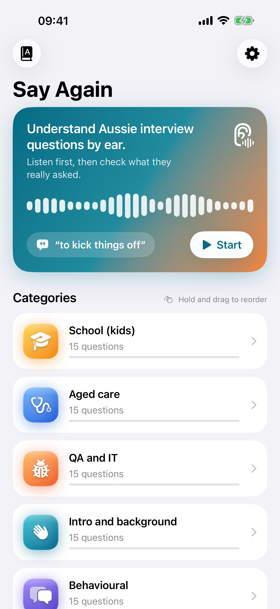
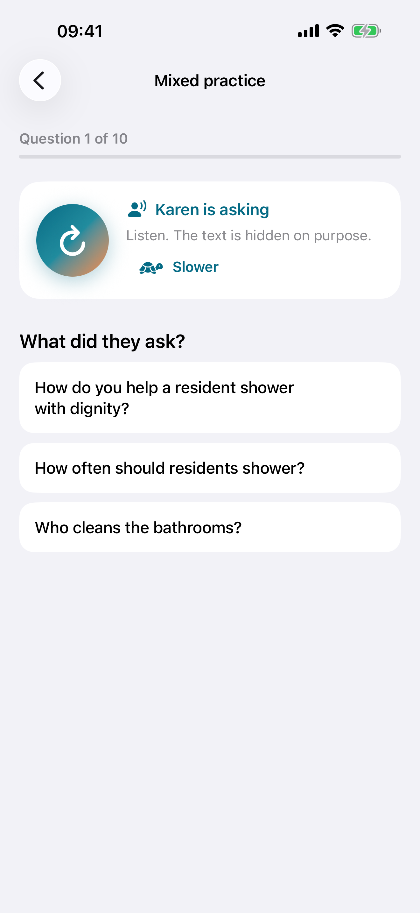
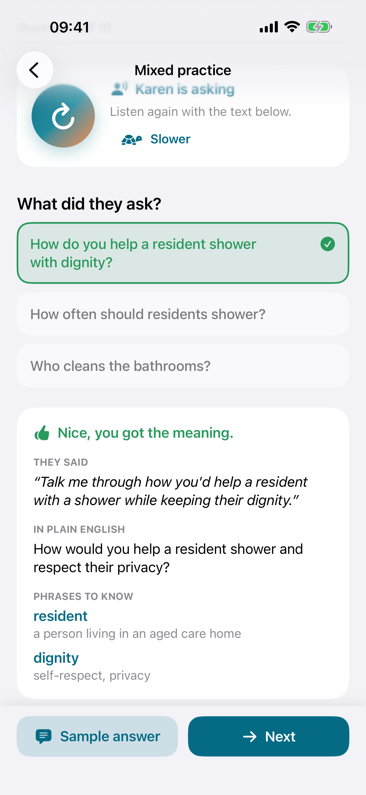
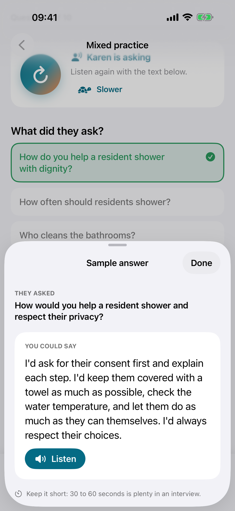
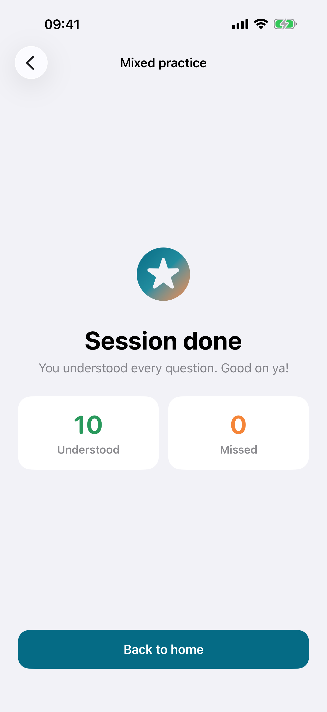
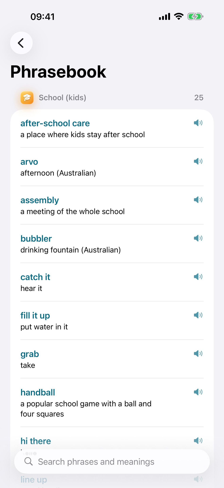

# Say Again: Aussie Interviews

[](https://github.com/flakyhunter/SayAgain/actions/workflows/ci.yml)

A free iOS app that helps you **understand Australian interview questions by ear**:
the accent, the slang, and the way interviewers really ask things
("Righto, last one from me...", "Have you had a crack at...").

<p align="center">
  
  
  
</p>
<p align="center">
  
  
  
</p>
<p align="center"><sub>App Store screenshots, captured by a UI test (<code>scripts/screenshots.sh</code>).</sub></p>

## What it does

- **Listen first.** A question is read by an Australian voice; the text stays hidden. Different
  interviewers take turns (Karen, Lee, Matilda), and a slow mode reads phrase by phrase with pauses.
- **Check what they asked.** Pick the meaning from three options, then see the original words,
  a plain-English version and the phrases that trip people up ("arvo", "a heap on your plate").
- **Know what to say.** Every question has a sample answer in simple English with
  [placeholders] for your own details, and you can listen to it.
- **Remember.** Spaced repetition brings missed questions back sooner. Each category shows
  "8 of 15 understood"; finish one and you get a celebration and a Start over button.
- **Seven categories, 105 questions:** school (for kids), aged care, QA and IT, intro and background,
  behavioural, salary and logistics, volunteering. Drag categories to put yours first.
- **Phrasebook** with search and audio for all 197 phrases. **Russian translation** can be turned on
  in Settings, including full translations for the kids' school category.
- Free, no ads, no accounts, nothing leaves the phone.
  [Support](https://flakyhunter.github.io/SayAgain/) · [Privacy Policy](https://flakyhunter.github.io/SayAgain/privacy.html)

> Status: **feature-complete for v1**, preparing the App Store release (TestFlight next).

## Why this repo exists

This is a personal portfolio project by a QA automation engineer. The app is real and useful,
but the focus is on how it is tested and shipped:

- a test pyramid: many fast unit tests, a snapshot layer, a few stable UI journeys,
- a deterministic UI-test mode (fixed content and seed, silent speech, no animations),
- page objects and shared accessibility identifiers instead of text-based queries,
- content that is validated by tests like code,
- CI on every push and pull request.

## Test strategy

| Level | Tooling | What it covers | Tests | Runs on |
|---|---|---|---|---|
| Unit | Swift Testing | Content rules (105 questions, 15+ per category, translations, placeholders, no city names), Leitner scheduling, session state machine, seeded shuffling, slow-mode phrase splitting, category order, mastery and start over, phrasebook search, view models with a recording speech double, settings | 80 | macOS + simulator, about 1 s |
| Snapshot | [swift-snapshot-testing](https://github.com/pointfreeco/swift-snapshot-testing) | Home (light, dark, empty, progress, mastered), practice (answering, wrong, right in dark, single-voice hint), sample answer, summary, mastered summary, settings, phrasebook and kids' answer in Russian, every category icon in both themes | 15 | iOS Simulator, a few seconds |
| UI | XCUITest + page objects | Full session, replay and slow mode, ten fast answers on the real content, mastering a category and starting over, drag to reorder, settings, phrasebook search in English and Russian | 10 | iOS Simulator |

Plus one UI test that produces the App Store screenshots (skipped in normal runs).
A full CI run takes about 10 minutes, most of it is the simulator on the GitHub runner.

Key decisions:

- **Shared contract.** `SayAgainKit` exposes `A11yID` and `LaunchArgument`, used by both the app
  and the UI tests, so a renamed identifier breaks the build, not a test run.
- **Deterministic UI tests.** `-uiTesting` swaps in fixture content, a silent recording speech
  service, in-memory progress and a fixed random seed, and turns off animations. `-bundledContent`
  runs the same mode on the real 105 questions. Tests wait on elements, never on `sleep`.
- **Pure core.** `PracticeSession`, `LeitnerScheduler`, `CategoryOrder` and `SpeechChunker` are
  plain values and functions with no UI or audio, so every rule is a fast unit test.
- **Observable without peeking.** UI tests check that audio played through the play button's
  accessibility value ("Played 2 times"), which also helps VoiceOver users.
- **Content is code.** Every question must pass the validator: unique ids, exactly two
  distractors, no distractor equal to the answer, no empty fields, typography rules.

## Bugs found while building (and what changed)

Real findings from building this app, kept here because they are the point of the project:

| What happened | How it was found | Fix and guard |
|---|---|---|
| The app shipped without an icon: the icon set lost its `Contents.json`, the build skipped it silently | Manual check on the simulator home screen | Restored the file; a bundle test now asserts the icon and Info.plist values are compiled in |
| Home did not refresh progress after a session | New UI test for mastering a category | Progress is re-read when navigation changes |
| "Start over" on a card was merged into the card for VoiceOver and tests | UI test could not find the button | Button moved next to the card, not inside it |
| The explanation sometimes stayed under the bottom bar | User report; reproduced with animations on | Scroll waits for the appear animation to finish; checked 6 of 6 with animations |
| "Slower" barely changed anything | User report; measured the audio length | The rate scale is not linear (+13 % only); slow mode now reads phrase by phrase with pauses (x1.45, measured) |
| CI failed: the pinned Xcode on the runner had no matching simulator | First CI run | Use the runner's default Xcode and the latest simulator; snapshots pass across iOS 26.1 and 26.5 |

## Project layout

```
App/                     SwiftUI app target (views, view models, launch environment)
AppTests/                Snapshot and view model tests (hosted)
UITests/                 XCUITest journeys and page objects (Screens/)
Packages/SayAgainKit/    Models, content, validation, scheduling, test contract - no UI
AppStore/screenshots/    App Store screenshots (6.9-inch)
docs/                    Support and privacy pages (GitHub Pages)
scripts/                 screenshots.sh
project.yml              XcodeGen spec (the .xcodeproj is generated, not committed)
```

## Run locally

Requires Xcode 26.1+ and [XcodeGen](https://github.com/yonaskolb/XcodeGen).

```sh
brew install xcodegen
xcodegen generate
swift test --package-path Packages/SayAgainKit
xcodebuild test -project SayAgain.xcodeproj -scheme SayAgain \
  -destination "platform=iOS Simulator,name=iPhone 17 Pro"
./scripts/screenshots.sh   # App Store screenshots into AppStore/screenshots
```

## Roadmap

- **v0** - skeleton, first tests on every level, CI. *(done)*
- **v1** - practice loop, spaced repetition, sample answers, 7 categories, phrasebook, Russian
  translation, settings, screenshots, support and privacy pages. *(done)* TestFlight from CI and
  App Store release. *(next)*
- **v2** - AI feedback on your retelling of the question, covered by an LLM eval suite in CI.

## Privacy

No accounts, no analytics, no tracking. Progress and settings stay on the device. Speech is
generated on the device by the system voices. Full policy: [privacy page](https://flakyhunter.github.io/SayAgain/privacy.html).

## About me

Aleksander Matsko - QA Automation Engineer / SDET, Perth, Western Australia.
iOS and web test automation, API testing, AI-assisted QA workflows.

[LinkedIn](https://www.linkedin.com/in/aleks-matsko/) · [GitHub](https://github.com/flakyhunter)

## License

MIT
