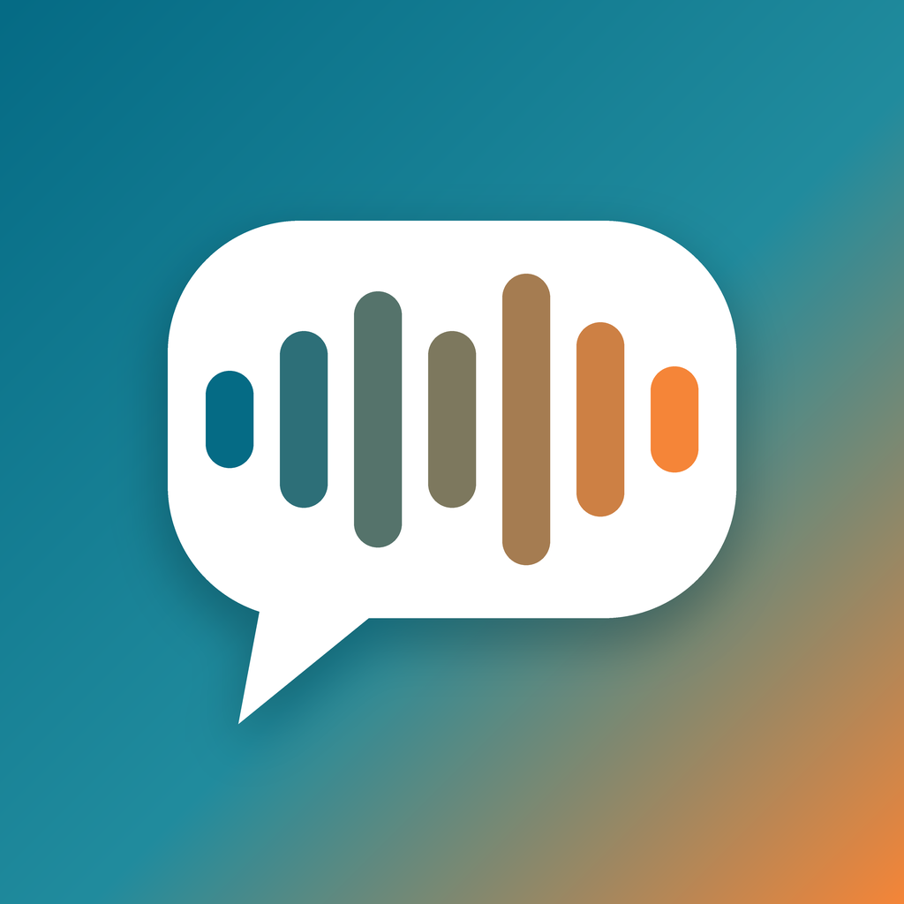
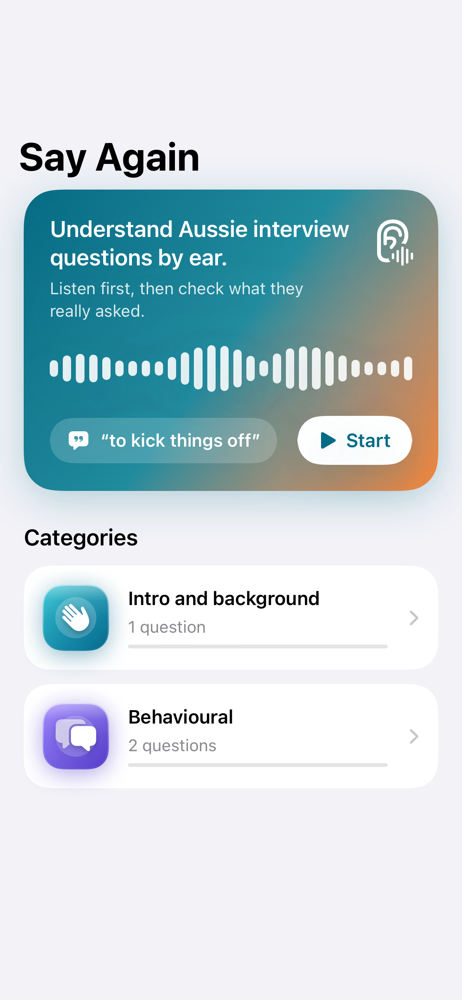
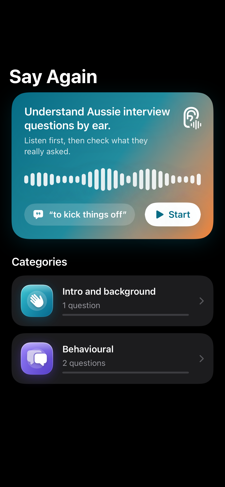

# Say Again: Aussie Interviews

[](https://github.com/flakyhunter/SayAgain/actions/workflows/ci.yml)

A free iOS app that helps you **understand Australian job interview questions by ear**:
the accent, the slang, and the way interviewers really ask things
("Righto, last one from me...", "Have you had a crack at...").

You listen to a question first, pick what you think they asked, then see the original text,
a plain-English version and the phrases that usually trip people up. Every question also has
a sample answer in simple English, with [placeholders] for your own details, that you can listen to.

Categories: intro and background, behavioural, salary and logistics, QA and IT, volunteering,
aged care, school (for kids). 105 questions, read by the Australian voices installed on the device.

> Status: **v1 in progress.** The practice loop works: listen, choose the meaning, see the answer, rate yourself.
> Next: more questions, settings, TestFlight.

<p align="center">
  
  &nbsp;&nbsp;
  
</p>
<p align="center"><sub>Rendered by the snapshot tests themselves: the same images CI compares on every run.</sub></p>

## Why this repo exists

This is a personal portfolio project by a QA automation engineer. The app is small on purpose;
the focus is on how it is tested and shipped:

- a test pyramid with fast unit tests at the bottom and a few stable UI tests at the top,
- a deterministic UI-test mode (no network, fixed content, no animations),
- page objects and shared accessibility identifiers instead of text-based queries,
- content that is validated by tests like code,
- CI on every push and pull request.

## Test strategy

| Level | Tooling | What it covers | Tests | Runs on |
|---|---|---|---|---|
| Unit | Swift Testing | Content rules (105 questions in 7 categories, 15+ each, no city-specific text, sample answers with balanced placeholders), Leitner scheduling, session state machine, seeded shuffling, progress storage, view model with a recording speech double, voice rotation, settings | 48 | macOS + simulator, under 1 s |
| Snapshot | [swift-snapshot-testing](https://github.com/pointfreeco/swift-snapshot-testing) | Home (light, dark, empty, with progress), practice (answering, wrong, right in dark), summary, single-voice hint, settings, sample answer, all category icons | 12 | iOS Simulator, ~3 s |
| UI | XCUITest + page objects | Full session from home to summary, replay, home content, reset progress with confirmation, slow-by-default setting | 5 | iOS Simulator |

Numbers as of the current commit. A full CI run takes about 7 minutes, most of it is the simulator boot on the
GitHub runner. Snapshots recorded on iOS 26.1 locally pass on iOS 26.5 in CI.

Key decisions:

- **Shared contract.** `SayAgainKit` exposes `A11yID` and `LaunchArgument`, used by both the app
  and the UI tests, so a renamed identifier breaks the build, not a test run.
- **Deterministic UI tests.** `-uiTesting` swaps in fixture content, a silent recording speech
  service, in-memory progress and a fixed random seed, and turns off animations. The same seed
  means the same question order and answer positions on every run. Tests wait on elements,
  never on `sleep`.
- **Pure core.** `PracticeSession` is a value type with no UI or audio; every rule (a wrong
  answer always counts as missed, actions in the wrong phase are ignored) is a unit test.
- **Observable without peeking.** UI tests check that audio played through the play button's
  accessibility value ("Played 2 times"), which also helps VoiceOver users.
- **Content is code.** Every question must pass the validator: unique ids, exactly two
  distractors, no distractor equal to the answer, no empty fields, typography rules.

## Project layout

```
App/                     SwiftUI app target (thin: views + launch environment)
AppTests/                Snapshot and environment tests (hosted)
UITests/                 XCUITest scenarios and page objects (Screens/)
Packages/SayAgainKit/    Models, content, validation, test contract - no UI
project.yml              XcodeGen spec (the .xcodeproj is generated, not committed)
```

## Run locally

Requires Xcode 26.1+ and [XcodeGen](https://github.com/yonaskolb/XcodeGen).

```sh
brew install xcodegen
xcodegen generate
swift test --package-path Packages/SayAgainKit
xcodebuild test -project SayAgain.xcodeproj -scheme SayAgain \
  -destination "platform=iOS Simulator,name=iPhone 17 Pro"
```

## Roadmap

- **v0** - skeleton, first tests on every level, CI. *(done)*
- **v1** - *(in progress)* practice loop (listen, choose, reveal, self-rate), spaced repetition, 60+ questions,
  TestFlight from CI, App Store release.
- **v2** - AI feedback on your retelling of the question, covered by an LLM eval suite in CI.

## Privacy

No accounts, no analytics, no tracking. Progress stays on the device. Speech is generated
on the device by the system voices.

## About me

Aleksander Matsko - QA Automation Engineer / SDET, Perth, Western Australia.
iOS and web test automation, API testing, AI-assisted QA workflows.

[LinkedIn](https://www.linkedin.com/in/aleks-matsko/) · [GitHub](https://github.com/flakyhunter)

## License

MIT
